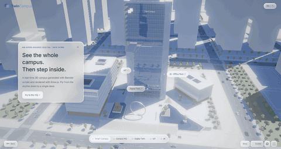
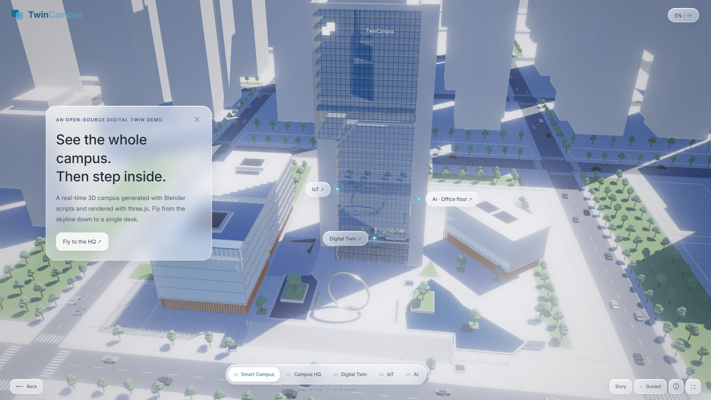
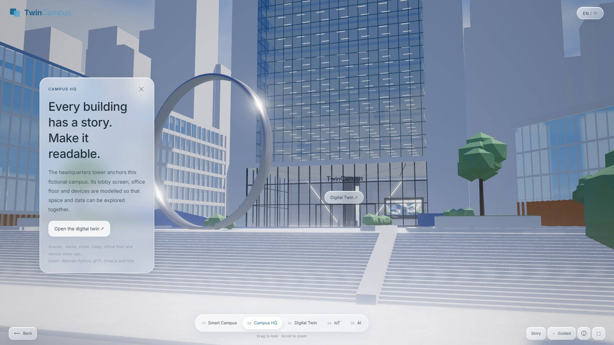
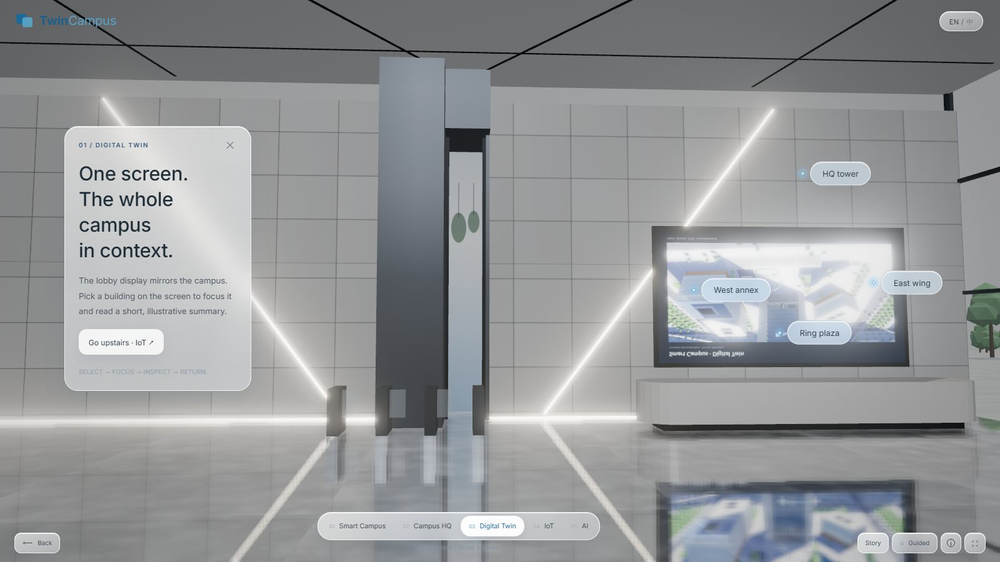
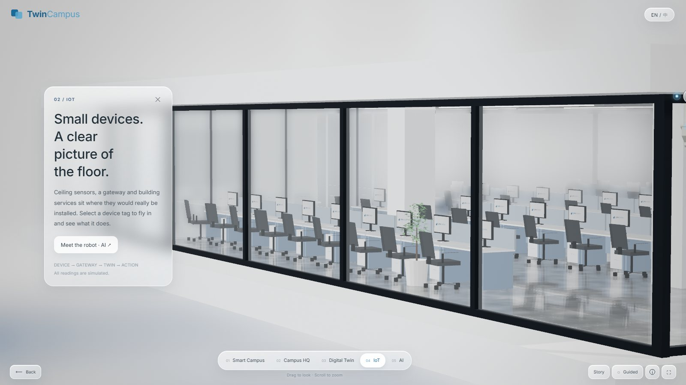
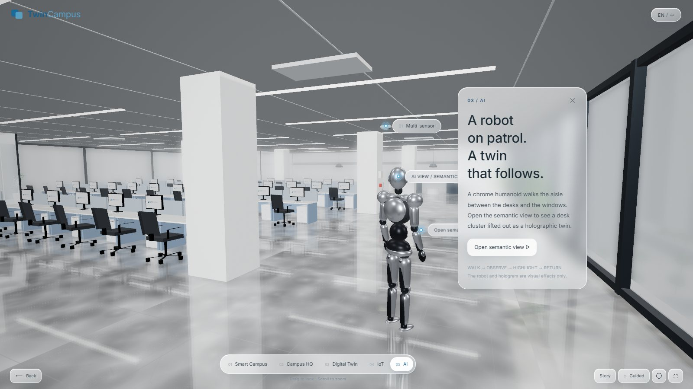
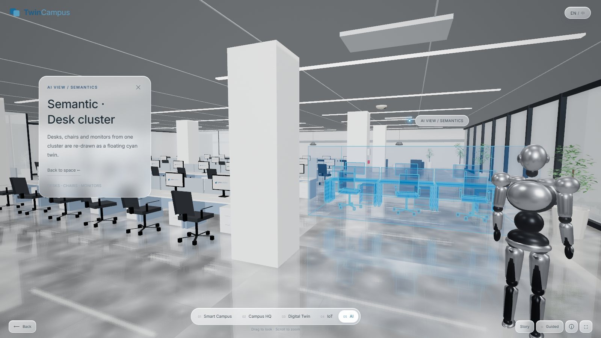
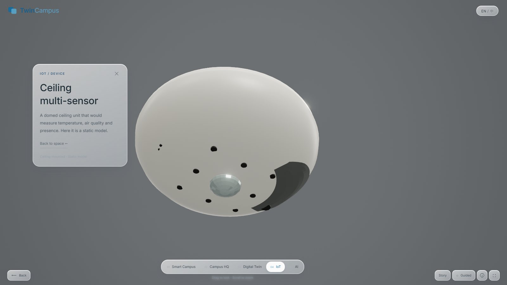
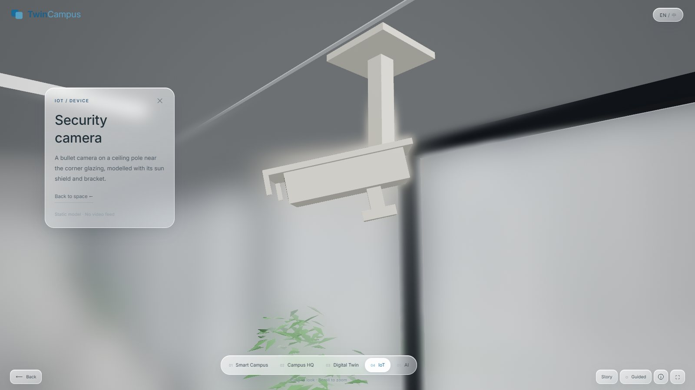
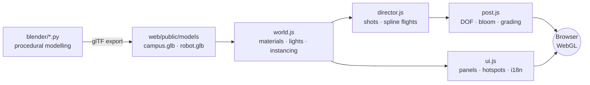

<div align="center">


# Twin Campus

**An open-source, real-time 3D digital-twin campus. Every building is generated by a Blender script and rendered in the browser with three.js.**

Fly from the skyline to the lobby screen, up to an office floor, and down to a single ceiling sensor. It is a static site with zero backend that deploys to GitHub Pages in about 3 clicks.

[](https://wangzh12023.github.io/twin-campus/)
[](https://github.com/wangzh12023/twin-campus/fork)

[](https://threejs.org)
[](https://www.blender.org)
[](https://vite.dev)
[](https://nodejs.org)
[](https://github.com/wangzh12023/twin-campus/actions/workflows/deploy.yml)
[](LICENSE)
[](https://github.com/wangzh12023/twin-campus/pulls)
[](https://github.com/wangzh12023/twin-campus/stargazers)

**English** · [简体中文](README.zh-CN.md)



</div>

---

## ✨ Highlights

| | |
|---|---|
| 🏙️ **100% procedural scene** | Towers, annexes, road grid, ~780 trees, cars, the lobby and a furnished office floor all come from Python scripts in [`blender/`](blender). There are no hand-made `.blend` files: change a number, rebuild in about 10 s. |
| 🎬 **Cinematic camera director** | Five chapters plus device close-ups, joined by spline flights with eased timing. Zone changes are hidden behind a white flash, and an idle drift keeps every shot alive. |
| 💎 **Custom rendering** | A curtain-wall glass shader with procedural mullions, Fresnel and planar reflections. Also mirror-polished floors, depth of field, bloom, ACES grading and soft PCF shadows. |
| 🧊 **Glassmorphism UI** | Frosted info panels, hotspots that track 3D anchors, a chapter bar, a live lobby "dashboard" screen, and an EN / 中文 switch. |
| 🤖 **Robot + hologram** | A chrome humanoid patrols the office aisle. The semantic view lifts a desk cluster out as a floating cyan twin. |
| 🚀 **Zero backend** | One `npm run build` produces a static `dist/`. A GitHub Actions workflow publishes it to Pages on every push. |

## 📸 Screenshots

<table>
  <tr>
    <td><br/><sub><b>01 · Smart Campus</b>: aerial overview with live hotspots</sub></td>
    <td><br/><sub><b>02 · Campus HQ</b>: ring plaza and grand stair</sub></td>
  </tr>
  <tr>
    <td><br/><sub><b>03 · Digital Twin</b>: lobby screen mirrors the campus</sub></td>
    <td><br/><sub><b>04 · IoT</b>: the office floor as a glass box</sub></td>
  </tr>
  <tr>
    <td><br/><sub><b>05 · AI</b>: robot patrol in the aisle</sub></td>
    <td><br/><sub><b>AI view</b>: holographic desk cluster</sub></td>
  </tr>
  <tr>
    <td><br/><sub><b>Device</b>: ceiling multi-sensor</sub></td>
    <td><br/><sub><b>Device</b>: security camera</sub></td>
  </tr>
</table>

## 🚀 Deploy your own copy (3 clicks, no terminal)

> You only need a GitHub account.

1. **Fork** this repo: [click here](https://github.com/wangzh12023/twin-campus/fork) → *Create fork*.
2. In your fork go to **Settings → Pages**, and under *Build and deployment → Source* pick **GitHub Actions**.
3. Open the **Actions** tab. If asked, click *"I understand my workflows, go ahead and enable them"*. Then choose **Deploy to GitHub Pages → Run workflow**.

☕ About 1 minute later your site is live at:

```
https://<your-github-name>.github.io/twin-campus/
```

After that, every push to `main` redeploys automatically. Any static host works too: upload `web/dist/` to Netlify, Vercel, Cloudflare Pages or any web server.

## 💻 Run locally (1 command)

Requires [Node.js](https://nodejs.org) 20.19+ or 22.12+.

```bash
git clone https://github.com/wangzh12023/twin-campus.git
cd twin-campus/web && npm install && npm run dev
```

The browser opens at **http://127.0.0.1:5183** automatically. To produce a production build, run `npm run build`, which writes the static site to `web/dist/`.

## 🎮 Controls

| Action | How |
|---|---|
| Next chapter / open a detail | Click the button in the info panel, a chapter in the bottom bar, or any floating hotspot |
| Look around · zoom | Drag · mouse wheel |
| Free orbit | Bottom-right **Guided / Explore** toggle |
| Autoplay tour | Bottom-right **Story** |
| Back · skip flight | `Esc` · `Space` (or the buttons bottom-left) |
| Language | `EN / 中` top-right, or add `?lang=zh` to the URL |
| Deep link to a scene | `?state=campus` · `hq` · `twin` · `iot` · `ai` · `ai-sem` · `d-sensor` · `d-camera` … |

## 🛠️ Rebuild the 3D models (optional)

The generated models are already committed in `web/public/models/`, so you only need Blender if you want to change the scene.

```bash
# Blender 5.x, headless. Writes campus.glb + campus_instances.json / robot.glb into web/public/models
blender -b --factory-startup -P blender/build_campus.py
blender -b --factory-startup -P blender/build_robot.py
```

Then refresh the browser. Good starting points for tweaks are `blender/tower.py` (HQ tower), `blender/site.py` (roads, plaza, landscape), `blender/interiors.py` (lobby, office floor, devices) and `web/src/director.js` (camera shots and flights).

## 🧱 How it works



<details>
<summary><b>📂 Project structure</b></summary>

```text
twin-campus/
├── blender/                 # Blender Python: the whole scene is code
│   ├── build_campus.py      #   entry point → campus.glb
│   ├── site.py              #   ground, roads, plaza, ring, landscape, city blocks
│   ├── tower.py             #   HQ tower shell and lobby podium
│   ├── annexes.py           #   annex buildings
│   ├── interiors.py         #   lobby, office floor, furniture, IoT devices
│   ├── build_robot.py       #   humanoid robot → robot.glb
│   └── blib.py              #   tiny geometry / batching / export helpers
├── web/                     # three.js app (Vite)
│   ├── public/models/       #   generated glTF + instance data
│   └── src/
│       ├── main.js          #   app bootstrap, zone presets, render loop
│       ├── world.js         #   materials, lights, env maps, instancing
│       ├── director.js      #   camera shots + transition routes
│       ├── post.js          #   MSAA → DOF → bloom → ACES grade
│       ├── glass.js         #   curtain-wall glass shader
│       ├── reflection.js    #   planar reflections
│       ├── ui.js · content.js · style.css   # UI and EN/ZH copy
│       └── robot.js · holo.js · screen.js · sky.js · textures.js
├── tools/                   # headless capture (Playwright) + camera-fitting utilities
├── docs/                    # README assets
└── .github/workflows/deploy.yml   # GitHub Pages CI
```

</details>

## 🗺️ Roadmap

- [ ] Draco / KTX2 compression for a faster first load
- [ ] Touch-first layout for phones
- [ ] Example connector that streams live sensor values (MQTT / WebSocket) into the hotspots
- [ ] More device close-ups and an editable building panel

Ideas and PRs are very welcome. See below.

## 🤝 Contributing

1. Fork → create a branch (`git checkout -b feat/my-idea`)
2. `cd web && npm install && npm run dev`, make your change
3. Commit and open a Pull Request with a screenshot 📸

Found a bug? [Open an issue](https://github.com/wangzh12023/twin-campus/issues).

## 🙏 Acknowledgements

[three.js](https://threejs.org) · [Blender](https://www.blender.org) · [Vite](https://vite.dev) · [Inter](https://rsms.me/inter/) via Fontsource · [Playwright](https://playwright.dev) · [Shields.io](https://shields.io)

"Twin Campus" and all buildings, devices and text in the demo are fictional. No real organisation or live data is represented.

## 📄 License

[MIT](LICENSE) © 2026 Zihan Wang

<div align="center">

**If this project helped or inspired you, please give it a ⭐. It really helps!**

[](https://star-history.com/#wangzh12023/twin-campus&Date)

</div>
