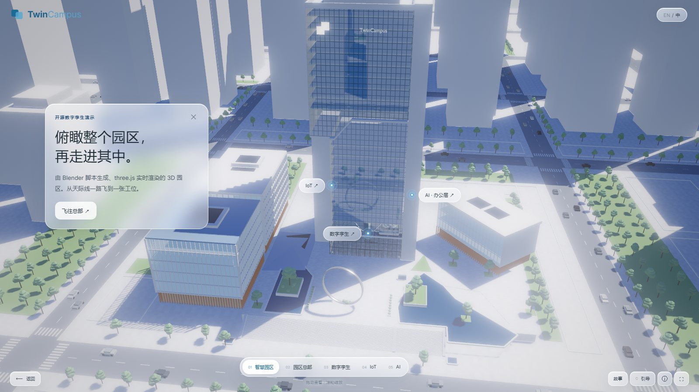
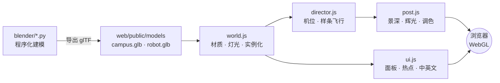

<div align="center">


# Twin Campus

**开源的实时 3D 数字孪生园区：每一栋楼都由 Blender 脚本生成，并在浏览器中用 three.js 实时渲染。**

从天际线一路飞到大堂屏幕、办公楼层，再到一个吸顶传感器。纯静态网站，无需后端，约 3 次点击即可部署到 GitHub Pages。

[](https://wangzh12023.github.io/twin-campus/)
[](https://github.com/wangzh12023/twin-campus/fork)

[](https://threejs.org)
[](https://www.blender.org)
[](https://vite.dev)
[](https://nodejs.org)
[](https://github.com/wangzh12023/twin-campus/actions/workflows/deploy.yml)
[](LICENSE)
[](https://github.com/wangzh12023/twin-campus/pulls)
[](https://github.com/wangzh12023/twin-campus/stargazers)

[English](README.md) · **简体中文**


</div>

---

## ✨ 亮点

| | |
|---|---|
| 🏙️ **100% 程序化场景** | 塔楼、附楼、路网、约 780 棵树、车辆、大堂和带家具的办公层，全部来自 [`blender/`](blender) 里的 Python 脚本。没有任何手工 `.blend` 文件：改一个数字，约 10 秒重新生成。 |
| 🎬 **电影级镜头导演** | 5 个章节加设备特写，用样条曲线飞行和缓动衔接。切换室内外时用白闪过渡，待机时镜头会轻微漂移。 |
| 💎 **自定义渲染** | 幕墙玻璃着色器（程序化竖梃、菲涅尔、平面反射），以及镜面抛光地面、景深、辉光、ACES 调色和柔和的 PCF 阴影。 |
| 🧊 **毛玻璃 UI** | 磨砂信息面板、跟随 3D 锚点的热点标签、章节栏、实时渲染的大堂“看板”屏幕，以及中 / 英切换。 |
| 🤖 **机器人 + 全息** | 金属人形机器人在办公走道巡逻；语义视图把一组工位提取成悬浮的青色孪生体。 |
| 🚀 **零后端** | 一次 `npm run build` 生成静态 `dist/`；GitHub Actions 在每次 push 后自动发布到 Pages。 |

## 📸 截图

<table>
  <tr>
    <td><br/><sub><b>01 · 智慧园区</b>：带热点的航拍总览</sub></td>
    <td><br/><sub><b>02 · 园区总部</b>：圆环广场与大台阶</sub></td>
  </tr>
  <tr>
    <td><br/><sub><b>03 · 数字孪生</b>：大堂屏幕映射整个园区</sub></td>
    <td><br/><sub><b>04 · IoT</b>：玻璃盒子般的办公层</sub></td>
  </tr>
  <tr>
    <td><br/><sub><b>05 · AI</b>：走道里巡逻的机器人</sub></td>
    <td><br/><sub><b>AI 视图</b>：全息工位组</sub></td>
  </tr>
  <tr>
    <td><br/><sub><b>设备</b>：吸顶多合一传感器</sub></td>
    <td><br/><sub><b>设备</b>：安防摄像机</sub></td>
  </tr>
</table>

## 🚀 部署你自己的一份（3 步，不用命令行）

> 只需要一个 GitHub 账号。

1. **Fork** 本仓库：[点这里](https://github.com/wangzh12023/twin-campus/fork) → *Create fork*。
2. 在你的 Fork 中打开 **Settings → Pages**，在 *Build and deployment → Source* 选择 **GitHub Actions**。
3. 打开 **Actions** 标签页。如有提示，点 *"I understand my workflows, go ahead and enable them"*，然后选择 **Deploy to GitHub Pages → Run workflow**。

☕ 大约 1 分钟后，网站就会上线：

```
https://<你的 GitHub 用户名>.github.io/twin-campus/
```

之后每次 push 到 `main` 都会自动重新部署。其他静态托管也可以：把 `web/dist/` 上传到 Netlify、Vercel、Cloudflare Pages 或任意 Web 服务器即可。

## 💻 本地运行（1 条命令）

需要 [Node.js](https://nodejs.org) 20.19+ 或 22.12+。

```bash
git clone https://github.com/wangzh12023/twin-campus.git
cd twin-campus/web && npm install && npm run dev
```

浏览器会自动打开 **http://127.0.0.1:5183**。生产构建用 `npm run build`，静态网站会输出到 `web/dist/`。

## 🎮 操作

| 操作 | 方法 |
|---|---|
| 下一章 / 打开详情 | 点击信息面板里的按钮、底部章节栏，或任意悬浮热点 |
| 环视 · 缩放 | 拖动 · 鼠标滚轮 |
| 自由环绕 | 右下角 **引导 / 探索** 切换 |
| 自动漫游 | 右下角 **故事** |
| 返回 · 跳过飞行 | `Esc` · `空格`（或左下角按钮） |
| 语言 | 右上角 `EN / 中`，或在网址后加 `?lang=zh` |
| 直达某个场景 | `?state=campus` · `hq` · `twin` · `iot` · `ai` · `ai-sem` · `d-sensor` · `d-camera` … |

## 🛠️ 重新生成 3D 模型（可选）

生成好的模型已提交在 `web/public/models/`，只有想修改场景时才需要 Blender。

```bash
# Blender 5.x 无界面运行，输出 campus.glb + campus_instances.json / robot.glb 到 web/public/models
blender -b --factory-startup -P blender/build_campus.py
blender -b --factory-startup -P blender/build_robot.py
```

然后刷新浏览器即可。推荐从这些文件入手修改：`blender/tower.py`（总部大楼）、`blender/site.py`（道路、广场、景观）、`blender/interiors.py`（大堂、办公层、设备），以及 `web/src/director.js`（镜头机位与飞行路线）。

## 🧱 工作原理



<details>
<summary><b>📂 目录结构</b></summary>

```text
twin-campus/
├── blender/                 # Blender Python：整个场景都是代码
│   ├── build_campus.py      #   入口 → campus.glb
│   ├── site.py              #   地面、道路、广场、圆环、景观、城市街区
│   ├── tower.py             #   总部大楼外壳与大堂裙楼
│   ├── annexes.py           #   附楼
│   ├── interiors.py         #   大堂、办公层、家具、IoT 设备
│   ├── build_robot.py       #   人形机器人 → robot.glb
│   └── blib.py              #   几何 / 合批 / 导出小工具
├── web/                     # three.js 应用（Vite）
│   ├── public/models/       #   生成的 glTF 与实例数据
│   └── src/
│       ├── main.js          #   启动、区域预设、渲染循环
│       ├── world.js         #   材质、灯光、环境贴图、实例化
│       ├── director.js      #   镜头机位与转场路线
│       ├── post.js          #   MSAA → 景深 → 辉光 → ACES 调色
│       ├── glass.js         #   幕墙玻璃着色器
│       ├── reflection.js    #   平面反射
│       ├── ui.js · content.js · style.css   # UI 与中英文文案
│       └── robot.js · holo.js · screen.js · sky.js · textures.js
├── tools/                   # 无头截图（Playwright）与相机拟合工具
├── docs/                    # README 资源
└── .github/workflows/deploy.yml   # GitHub Pages 自动部署
```

</details>

## 🗺️ 路线图

- [ ] Draco / KTX2 压缩，加快首屏加载
- [ ] 适配手机的触屏布局
- [ ] 示例连接器：把实时传感器数据（MQTT / WebSocket）接入热点
- [ ] 更多设备特写与可编辑的楼宇面板

欢迎提出想法或提交 PR，方法见下文。

## 🤝 参与贡献

1. Fork → 新建分支（`git checkout -b feat/my-idea`）
2. `cd web && npm install && npm run dev`，完成修改
3. 提交并发起 Pull Request，最好附一张截图 📸

发现 Bug？[提交 Issue](https://github.com/wangzh12023/twin-campus/issues)。

## 🙏 致谢

[three.js](https://threejs.org) · [Blender](https://www.blender.org) · [Vite](https://vite.dev) · [Inter](https://rsms.me/inter/)（Fontsource） · [Playwright](https://playwright.dev) · [Shields.io](https://shields.io)

“Twin Campus” 以及演示中的建筑、设备和文字均为虚构，不代表任何真实机构，也未接入任何实时数据。

## 📄 许可证

[MIT](LICENSE) © 2026 Zihan Wang

<div align="center">

**如果这个项目对你有帮助或启发，欢迎点一个 ⭐，这对我很重要！**

[](https://star-history.com/#wangzh12023/twin-campus&Date)

</div>
